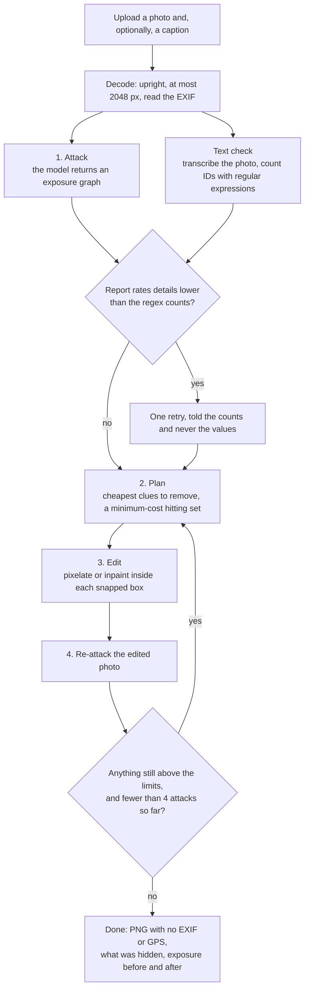
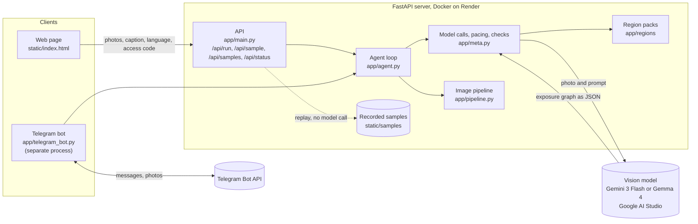

# Snap Safe India

A privacy agent for photos shared in India. It looks at a photo the way a stranger would, finds what gives you away
(an Aadhaar card, a number plate, a house name board, a courier label, a UPI screen), picks the fewest edits that hide
it, makes them, and checks the result again. It reports what a stranger could learn and how precisely, but never prints
the names, addresses or numbers themselves.

Built for **Hacktoberfest Hack Day x AI for Vizag** (Nov 1, 2026).

## What it adds to the project it grew out of

- **Detection for India** ([app/regions/india.py](app/regions/india.py)). A text check recognizes Aadhaar numbers (with
  the Verhoeff checksum, so a tracking number is not mistaken for one), PAN, GSTIN and voter ID numbers, vehicle number
  plates (including BH series), UPI IDs, IFSC codes, Indian mobile numbers (`+91 98765 43210`), PIN codes, and address
  words such as "Door No.", "Flat No.", "Nagar" and "Colony". The attacker prompt also lists Indian clues (ID cards, RC
  books, wedding invitations, payment QR codes, courier labels, uniforms) and asks it to read Telugu, Hindi and Tamil.
- **Region packs.** India is one pack among several, so the tool is not tied to one country. A pack is one file in
  [app/regions](app/regions) with its ID patterns, address formats and prompt note. A small US pack is included (SSN, ZIP
  codes, "Apt 4B"). Choose packs with `REGION=in,us`; `REGION=global` uses none; the default is `in`. To add a country,
  copy `india.py`, change the patterns and the note, register it in `app/regions/__init__.py`, and keep its self-check
  passing: `uv run python -m app.regions.india`.
- **Any OpenAI-compatible vision model** through `OPEN_API_BASE` and `OPEN_MODEL`, with request pacing per model
  (`OPEN_RPM`) so a free key does not answer 429s, and an optional **second model for the re-attacks**
  (`OPEN_RECHECK_MODEL`): it has its own quota, and a second opinion on the edited photo is a better check than the same
  model grading its own edits.
- **Report language.** The exposure report can be written in English, Telugu or Hindi (a dropdown on the page, `/lang` in the
  bot). Only the prose changes: clue labels and the edits stay the same. The Telugu and Hindi reports have been tested and work.
- **A Telegram bot** that takes a photo and sends back the cleaned copy (see below).
- **A rendered Indian benchmark** ([bench/india](bench/india), [bench/indiabench.py](bench/indiabench.py)), a new look,
  and a new logo.

## How it works

1. **Attack:** the model builds an exposure graph: clues (a number plate, a name board) lead to inferences (where you
   live, who you are), each with how precise it gets, from broad to exact.
2. **Plan:** a minimum-cost hitting set picks the cheapest clues to remove so nothing specific or exact can still be
   inferred.
3. **Edit:** each chosen clue is pixelated or inpainted inside the model's box, and the result is composited back only
   inside that area, so every other pixel is unchanged.
4. **Re-attack:** the edited photo is attacked again, and anything still exposed goes through another round, up to four
   attacks. The download is a PNG with no EXIF or GPS data.

What happens to one photo:



A deterministic text check runs beside the first attack. It counts emails, phone numbers, IDs and addresses with
regular expressions, so text written in a photo cannot talk the model out of a report.

### Architecture



More diagrams (a live check step by step, the exposure graph, region packs, the benchmark and deployment) are in [docs/architecture.md](docs/architecture.md).

## Which model

| Model | What we saw | Use |
|---|---|---|
| `gemini-3-flash-preview` | On the ID-card scene it hid every value in 53 s, and the transcription of the result read only the field labels. The boxes sit on the text. One photo, one run. | Demo model. Free tier: **20 requests a day**, 5 a minute, so it needs billing for live use. |
| `gemma-4-26b-a4b-it` | Its quota was still free when Gemini 3 Flash's ran out, but it took 50 to 90 s per attack and boxes in the wrong places. In a recorded run "Teja Kondapalli" and the end of "Gandhi Nagar" stayed readable, and a live wedding-invite run left the RSVP phone number visible after two rounds. | Free fallback, and an open-weight option. |
| `gemini-3.1-flash-lite`, `gemini-3.5-flash-lite` | Fast (3 to 4 s). As a first attack they return one box around the whole card, so they cannot place edits. As a re-checker, each flagged an unedited PAN card and passed a clean ID card in a one-photo test, but in a full run `gemini-3.1-flash-lite` boxed the whole card in every round, so the agent pixelated nearly the whole photo and still reported "exact". | Not used. |

Gemma 4 on this key is only the 26B model; the 31B model returned a server error every time we tried it.

## Benchmark

Ten rendered Indian scenes are defined, and the benchmark runs five core ones by default (`--all` runs all ten): an ID card, a courier label, a number plate, a Telugu sign, and a control with nothing personal. Planted fictional secrets (ID cards, a courier label, a number plate, a UPI screen, a
Telugu shop sign, a wedding invite, and a control with nothing personal). A secret counts as removed only if it was
readable in the original and is gone from the result. The scenes are drawn, not photographed, and the verifier is the
same kind of model as the attacker. See [bench/india](bench/india).

First run, with Gemma 4, with the original lenient scoring that checked full names only (one run each):

| | India pack on | India pack off |
|---|---|---|
| Planted secrets removed | 26 of 26 | 24 of 26 |
| Scenes with every secret removed | 9 of 9 | 8 of 9 |
| Share of the photo changed | 7.0% | 8.2% |

With the pack off, the model missed the whole PAN card and changed twice as much of the parcel label. This is one run on
rendered scenes, and the two-secret gap comes from a single scene, so it could be luck.

**That scoring was too lenient.** It counted a half-hidden name as removed, and the Gemma sample above shows why that
matters. Scoring now also counts each word of a name on its own. Our latest run is with Gemini 3 Flash and the stricter scoring, India pack on: **19 of 19 planted secrets removed on the five core
scenes, 8.8% of the photo changed, nothing falsely flagged on the control**. It is one run each, two of the five scenes come from
before the final literal check was added, and the same scenes had failed before (the ID card at 2 of 7, the Telugu sign at 1 of 4),
so read it as "the fix works on those", not as proof of reliability. The pack-off comparison has not been run. Details and the
first-run numbers are in [docs/benchmark.md](docs/benchmark.md). Results are in
`bench/india/results/*-gemma4` and `bench/india/results/in`, and in `global` once the pack-off run is done.

## Run it

```bash
uv sync
cp .env.example .env     # add your Google AI Studio key
uv run --env-file .env uvicorn app.main:app --reload
```

Open http://localhost:8000. Without a key only the recorded samples play; `MOCK=1` runs the whole loop offline with a
placeholder attacker. Self-checks: `uv run python -m app.pipeline`, `app.meta`, `app.agent`, `app.regions.india`,
`app.regions.us`.

Re-record samples after changing the agent: `uv run --env-file .env python -m app.samples in_id_card in_parcel ...`.
Each recording remembers which model made it. Run the benchmark with `uv run --env-file .env python -m bench.indiabench`
(`REGION=global` for the pack-off run), then `python -m bench.india.publish` to fill the page's results section.

## Telegram bot

[app/telegram_bot.py](app/telegram_bot.py) puts the same agent behind a Telegram chat. Send it a photo (or an image as a file),
and it replies with the cleaned PNG, what was hidden, what a stranger could learn before and after, and an honest verdict.

1. In Telegram, talk to **@BotFather**, send `/newbot`, and copy the token it gives you.
2. Put it in `.env` as `TELEGRAM_BOT_TOKEN=...` (never commit it).
3. Run `uv run --env-file .env python -m app.telegram_bot` and keep that window open.
4. In the chat: `/unlock <access code>` (the same `LIVE_CODE` as the site, if one is set), then send a photo.

Commands: `/lang en|te|hi` for the report language, `/help`. One photo is checked at a time, others queue, and each chat is
limited to `BOT_RUNS_PER_HOUR` photos an hour (default 3), because the model's quota is the limit. It is a separate process
from the web page, so run it on a laptop for the demo. The offline self-check is
`uv run python -m app.telegram_bot --selftest`.

### Tested on real Telegram

Oct 31, 2026, one run on a laptop with the bot as a separate process, Gemini 3 Flash, access code on. The photo was the made-up
ID card from `bench/india/images/id_card.jpg`. The bot answered in about a minute, with a cleaned `safe-copy.png` and this report:

> This photo exposes a complete set of personal identification details, including full name, birth date, exact residential
> address, and an identification number.
>
> What a stranger could learn, before -> after:
> - Who you are: exact -> nothing
> - Where you live: exact -> nothing
> - ID and account numbers: exact -> nothing
>
> Hidden: name field on card, address line on card, identification number text, printed postal code
>
> My own re-check found nothing specific left. That is my judgment, not a guarantee, so look at the picture before you post it.


The name, date of birth, address, PIN and the long number are unreadable in the copy. The box over the name row is too big: it also
covers the "Name" label and part of the card heading. That is over-editing, not a leak. One run on one card, so it shows the bot works and not how reliable it is.

## Deploy on Render

[render.yaml](render.yaml) describes a free Docker web service with the Gemini settings filled in. Add `OPEN_API_KEY`
as a secret, and `LIVE_CODE` if you want live runs gated. Without a key the page plays recorded samples only, which is
the safe default for a public page. This has not been test-deployed yet.

## Privacy and limits

- Photos live in memory for one request and are not stored by this server. To find the clues, the photo is sent to the
  model's host (Google's Gemini API), whose own data terms apply, so test with staged photos.
- A check takes one to several minutes, mostly waiting on the model and its rate limit.
- Edits are pixelation and classic inpainting, which look rougher than generative edits.
- **"Verified" is the agent's own judgment** after re-attacking, not proof. It can be wrong, as the Gemma examples above
  show.
- The attacker is told never to print personal values; that is a prompt rule, not a filter.

## Docs

- [How it works](docs/how-it-works.md): each step of the agent, the box tightening, and what "verified" means
- [Models, quotas and what we tried](docs/models.md): measurements, free-tier limits, and what did not work
- [The Indian benchmark](docs/benchmark.md): method, commands and results (some tables are waiting for runs)
- [Deploy and configure](docs/deploy.md): Render steps, every setting, and the Telegram bot
- [Adding a country](docs/adding-a-country.md): a region pack is one file
- [Demo script](docs/demo-script.md) and [write-up text](docs/write-up.md), with placeholders for the results
- [Team plan](docs/team-plan.md): who does what before the event, with the order of work and the risks

## Layout

- `app/agent.py`: the loop (attack, plan, edit, re-attack) and the planner
- `app/meta.py`: model calls and pacing, the generic text patterns, and checks on what the model returns
- `app/regions/`: one file per country with its ID patterns, address formats and prompt note
- `app/pipeline.py`: image decoding limits, masks, blur, pixelate, inpaint and mask-bounded compositing
- `app/main.py`: `/api/run` streams progress as NDJSON; `/api/sample/{name}` replays a recorded run
- `app/samples.py`: recording and replaying the gallery runs
- `static/index.html`: the whole UI; `scripts/make_logo.py` draws the logo
- `bench/india`, `bench/indiabench.py`: the Indian benchmark (scenes, scorer, results)
- `docs/`: the pages listed above

## License

MIT, see [LICENSE](LICENSE). Original work copyright its author; modifications copyright their contributors.
