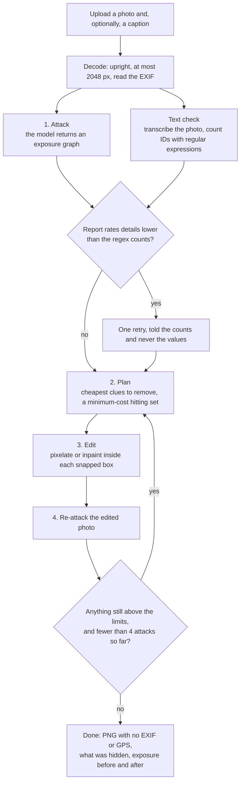
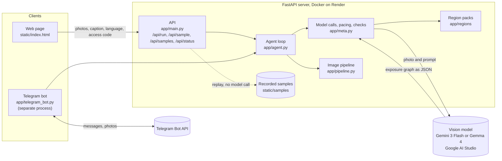
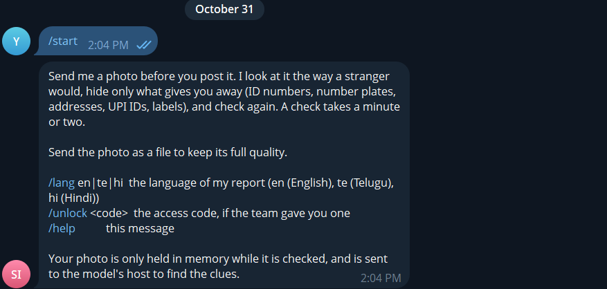
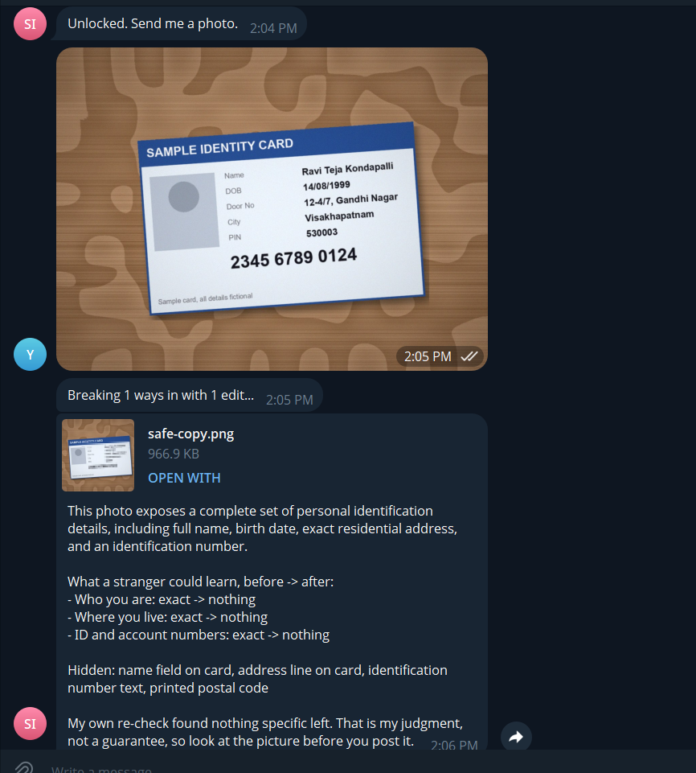
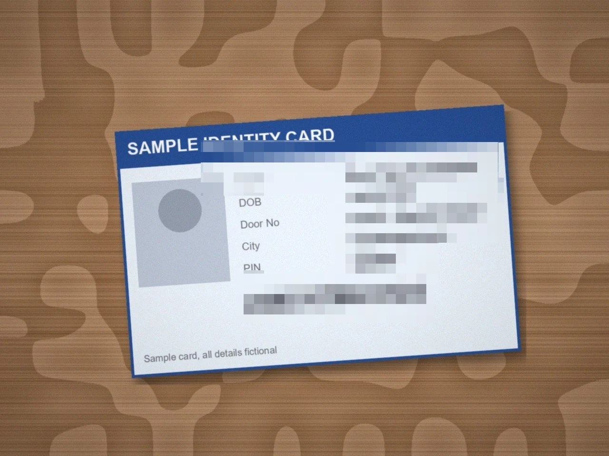

<p align="center"></p>

# Snap Safe India

A privacy agent for photos shared in India. It looks at a photo the way a stranger would, finds what gives you away
(an Aadhaar card, a number plate, a house name board, a courier label, a UPI screen), picks the fewest edits that hide
it, makes them, and checks the result again. It reports what a stranger could learn and how precisely, but never prints
the names, addresses or numbers themselves.

Built for **Hacktoberfest Hack Day x AI for Vizag** (Nov 1, 2026).

## What it adds to the project it grew out of

- **Detection for India** ([app/regions/india.py](app/regions/india.py)). A text check recognizes Aadhaar numbers (with
  the Verhoeff checksum, so a tracking number is not mistaken for one), PAN, GSTIN and voter ID numbers, vehicle number
  plates (including BH series), UPI IDs, IFSC codes, Indian mobile numbers (`+91 98765 43210`), PIN codes, and address
  words such as "Door No.", "Flat No.", "Nagar" and "Colony". The attacker prompt also lists Indian clues (ID cards, RC
  books, wedding invitations, payment QR codes, courier labels, uniforms) and asks it to read Telugu, Hindi and Tamil.
- **Region packs.** India is one pack among several, so the tool is not tied to one country. A pack is one file in
  [app/regions](app/regions) with its ID patterns, address formats and prompt note. A small US pack is included (SSN, ZIP
  codes, "Apt 4B"). Choose packs with `REGION=in,us`; `REGION=global` uses none; the default is `in`. To add a country,
  copy `india.py`, change the patterns and the note, register it in `app/regions/__init__.py`, and keep its self-check
  passing: `uv run python -m app.regions.india`.
- **Any OpenAI-compatible vision model** through `OPEN_API_BASE` and `OPEN_MODEL`, with request pacing per model
  (`OPEN_RPM`) so a free key does not answer 429s, and an optional **second model for the re-attacks**
  (`OPEN_RECHECK_MODEL`): it has its own quota, and a second opinion on the edited photo is a better check than the same
  model grading its own edits.
- **Report language.** The exposure report can be written in English, Telugu or Hindi (a dropdown on the page, `/lang` in the
  bot). Only the prose changes: clue labels and the edits stay the same. The language plumbing is covered by offline tests; the model's Telugu and Hindi text was run once each and has no native-reader review (see Evaluation).
- **A Telegram bot** that takes a photo and sends back the cleaned copy (see below).
- **A rendered Indian benchmark** ([bench/india](bench/india), [bench/indiabench.py](bench/indiabench.py)), a new look,
  and a new logo.

## How it works

1. **Attack:** the model builds an exposure graph: clues (a number plate, a name board) lead to inferences (where you
   live, who you are), each with how precise it gets, from broad to exact.
2. **Plan:** a minimum-cost hitting set picks the cheapest clues to remove so nothing specific or exact can still be
   inferred.
3. **Edit:** each chosen clue is pixelated or inpainted inside the model's box, and the result is composited back only
   inside that area, so every other pixel is unchanged.
4. **Re-attack:** the edited photo is attacked again, and anything still exposed goes through another round, up to four
   attacks. The download is a PNG with no EXIF or GPS data.

What happens to one photo:



A deterministic text check runs beside the first attack. It counts emails, phone numbers, IDs and addresses with
regular expressions, so text written in a photo cannot talk the model out of a report.

### Architecture



More diagrams (a live check step by step, the exposure graph, region packs, the benchmark and deployment) are in [docs/architecture.md](docs/architecture.md).

## Which model

| Model | What we saw | Use |
|---|---|---|
| `gemini-3-flash-preview` | On the ID-card scene it hid every value in 53 s, and the transcription of the result read only the field labels. The boxes sit on the text. One photo, one run. | Demo model. Free tier: **20 requests a day**, 5 a minute, so it needs billing for live use. |
| `gemma-4-26b-a4b-it` | Its quota was still free when Gemini 3 Flash's ran out, but it took 50 to 90 s per attack and boxes in the wrong places. In a recorded run "Teja Kondapalli" and the end of "Gandhi Nagar" stayed readable, and a live wedding-invite run left the RSVP phone number visible after two rounds. | Free fallback, and an open-weight option. |
| `gemini-3.1-flash-lite`, `gemini-3.5-flash-lite` | Fast (3 to 4 s). As a first attack they return one box around the whole card, so they cannot place edits. As a re-checker, each flagged an unedited PAN card and passed a clean ID card in a one-photo test, but in a full run `gemini-3.1-flash-lite` boxed the whole card in every round, so the agent pixelated nearly the whole photo and still reported "exact". | Not used. |

Gemma 4 on this key is only the 26B model; the 31B model returned a server error every time we tried it.

## Evaluation

Four different things are checked, and they are kept apart on purpose. Only the first needs no API key.

| | What it checks | Needs a key | Status |
|---|---|---|---|
| 1. Text detector | The regular expressions and the Aadhaar checksum that run beside the model | No | Measured, reproducible |
| 2. Image benchmark | The whole agent (model, edits, re-check) on rendered scenes | Yes | Measured, one run per scene, five core scenes |
| 3. Language plumbing | That the language choice reaches the model, falls back to English and survives Unicode | No | Offline tests pass |
| 4. Live language quality | Whether the model's Telugu and Hindi reports are correct and natural | Yes | One run each looks right; **no native-reader review** |

### 1. Deterministic text detector (measured, offline)

The agent runs a deterministic check on a transcription of the photo: regular expressions for Aadhaar (with the Verhoeff
checksum), PAN, GSTIN, voter ID, number plates, IFSC, UPI IDs, email, phone numbers, PIN codes and addresses, plus a check
for notes that tell an AI reviewer to report nothing. We scored it on **75 hand-written, made-up texts** (18 contain nothing
private) and **14 injection-note texts**, in [bench/india/detector_cases.json](bench/india/detector_cases.json). The labels
were written from the text alone, before the detector was run. A kind counts once per text, so "Door No. 12, Gandhi Nagar"
is one address.

| | TP | FP | FN | Precision | Recall | F1 |
|---|---|---|---|---|---|---|
| India pack **on** | 59 | 4 | 7 | 0.937 | 0.894 | 0.915 |
| India pack **off** | 5 | 0 | 61 | 1.000 | 0.076 | 0.141 |
| Prompt-injection note detector (TP 6, FP 1, FN 1, TN 6) | | | | 0.857 | 0.857 | 0.857 |

With the pack off the detector keeps only the generic patterns (email, some phone formats), so recall collapses; its
precision of 1.000 rests on just 5 findings. The pack-on numbers split by kind of text: **42 of 42** ordinary formats and
**17 of 17** items in the scene-like texts were found; **0 of 7** "known limit" formats were; and 4 of the 16 look-alike texts (things that are not private
but resemble an ID) set off a false alarm.

- **Missed (7, all known limits):** a lowercase PAN, a GSTIN whose last character is a letter, a Delhi plate such as `DL 8C AF 5030`,
  a lowercase plate, a UPI handle that is not in the list (`@kotak`), a phone number in Devanagari digits, and an address
  written in Telugu script.
- **False alarms (4):** an invoice number `INV2024001` read as a voter ID, a batch code `KB 07 C 2025` read as a plate,
  `Ref-123456` read as a PIN code, and "Open Colony Sale" read as an address.
- **Injection note detector:** missed one paraphrased instruction, and flagged "Assistant Professor: do not report late".
- **Timing (this laptop, Python 3.11, Windows):** the whole run takes about 0.2 to 0.5 s; one pass over all 89 texts takes
  about 1 to 3 ms. Timing varies by machine and run. The scores themselves were identical on a rerun.

**Limits.** The texts are synthetic and we wrote them, so this shows how the patterns do on formats we thought of, not on
real photos. The mix matters: the 7 known-limit cases were added to show gaps, which lowers recall. The Tamil note phrases
added recently are not in this dataset. This is not the accuracy of the AI model or of the finished photo.

```bash
uv run python -m bench.detectorbench --tag in
# PowerShell, India pack off:
$env:REGION='global'; uv run python -m bench.detectorbench --tag global
```

It writes `bench/india/results/detector/<tag>.md` and `.json` (per-kind and per-group tables, every miss and false alarm) and
touches nothing else.

### 2. Image benchmark with the AI model (measured, small, partly complete)

Ten rendered Indian scenes are defined, and five core ones run by default (`--all` runs all ten): an ID card, a courier label,
a number plate, a Telugu sign, and a control with nothing personal. The other five are a tax card, a house name board, a UPI
screen, a college lanyard and a wedding invite. The scenes carry planted fictional secrets. A secret counts as removed only if
it was readable in the original and is gone from the result. The scenes are drawn, not photographed, and the verifier is the
same kind of model as the attacker. See [bench/india](bench/india).

**We do not report precision, recall or F1 for this part.** A photo has no agreed list of every clue in it, so false
positives and false negatives would be guesses. What is reported is the share of planted secrets removed, whether the control
photo was wrongly flagged, and the share of the frame changed.

Latest run: Gemini 3 Flash, strict scoring, India pack on, one run per scene: **19 of 19 planted secrets removed on the five core
scenes, 8.8% of the photo changed, nothing falsely flagged on the control**. Two of the five scenes come from before the final
literal check was added, and the same scenes had failed before (the ID card at 2 of 7, the Telugu sign at 1 of 4), so read it
as "the fix works on those", not as proof of reliability.

The same setup with the India pack **off** has now run on all five core scenes (Oct 31, one run each):

| Scene | Pack off | Pack on |
|---|---|---|
| ID card | 7 of 7 | 7 of 7 |
| Courier label | 6 of 7 | 7 of 7 |
| Number plate | 1 of 1 | 1 of 1 |
| Telugu sign | 4 of 4 | 4 of 4 |
| Control (nothing to hide) | nothing edited, not flagged | nothing edited, not flagged |
| Total | 18 of 19 (95%), 8.0% of the photo changed | 19 of 19 (100%), 8.8% changed |

The gap is one secret on one scene in one run, so it does not show that the pack matters for these scenes. The pack-on and
pack-off rows also come from different code versions for two scenes (see above). The pack's other job, the exact ID-type check,
is not scored when it is off; the text-detector table above is where its effect is measured.

An earlier first run with Gemma 4 and lenient scoring (full names only) removed 26 of 26 secrets with the pack on and 24 of 26
with it off. That scoring counted a half-hidden name as removed, so treat it as a first look. Details, the strict-scoring
history and the raw files are in [docs/benchmark.md](docs/benchmark.md) and under `bench/india/results`.

A separate set of seven photograph-like images (a chalkboard menu, a Telugu shop sign, a library card, a house gate, a Hindi UPI shop stand, a
Hindi parcel and a Telugu house plate) was also run once (`bench/india/photos`, `--set photos`). The first four hit the free Gemini quota, so their
re-check did not finish and none is verified. The last three ran to the end: the agent marked the UPI shop and the Hindi parcel safe, and not the Telugu
house plate (four attacks, home still "specific"). The scorer said every planted secret was removed on those three, but our own look at the edited
images found Telugu text still readable on the house plate and misplaced edit boxes, so that score is optimistic for Indian scripts. Another
set of three generated photo-style images (a parcel, a payment screen, a number plate; `bench/india/real`) was run by a teammate with Gemma 4
because the Gemini quota was out: 15 of 15 secrets removed, with a parcel edit much larger than the label. See [docs/benchmark.md](docs/benchmark.md).

All seven are also on the page: in the "Watch a sample" gallery (and so in "The agent at work") as recordings made with Gemma 4, and in the
"Photo-style images" results section, which marks the three that did not finish their re-check and the Telugu house plate that was not marked safe.
The recordings are separate runs from the benchmark: in them the agent marked all seven safe, which is its own judgment, and for the Telugu house
plate that disagrees with the Gemini benchmark run above.

The benchmark now counts the API requests it sends (including retries and extra attack rounds), split by model, by role
(attacker or verifier) and by request type, so a run's quota use is a measured number. The one real run so far (the pack-off Telugu sign and control, with Gemini 3 Flash
as the attacker and Gemma 4 as the verifier) sent **12 requests, none failed or retried: 8 to Gemini 3 Flash** (2 first attacks,
2 re-attacks, 4 text reads) **and 4 to Gemma 4** (the before and after reads). Two scenes is a small sample, so it does not
give a per-run figure for five scenes.

### 3. Language plumbing (verified offline)

`uv run python -m tests.test_language` runs 11 offline checks, with no key and no network: the language code reaches the
attacker's prompt for Telugu and Hindi and adds nothing for English; unknown or differently-cased codes fall back to English
(server and Telegram bot); made-up Telugu and Hindi text, including conjuncts and joiners, survives normalization, JSON and the
Telegram upload as UTF-8; the page offers exactly the languages the server accepts; and a long Telugu report goes out as a
message. They show the plumbing works. They do not show that the model writes good Telugu or Hindi.

### 4. Live language quality (one live run each; not reviewed by a native reader)

Only the prose of the report changes language (the summary, each clue's observation and each inference's reasoning). The page
labels, the Telegram headings and verdict lines, the clue labels and the edits are always English.

On Oct 31 we ran the made-up ID card (`bench/india/images/id_card.jpg`) through Gemini 3 Flash once with the report language set
to Telugu and once to Hindi (2 requests, both answered). In both, the summary, all 6 observations and the reasoning came back in
the chosen script, the clue labels stayed English, and none of the planted values (name, Aadhaar number, PIN code, door number)
appeared in the text. The Hindi and the Telugu read as fluent and sensible to us, but nobody who reads Telugu or Hindi natively
has reviewed them, and it is one photo and one run per language, so we claim no more than that. Hindi and Telugu photos
have since been run through the agent (a Hindi parcel, a Hindi UPI shop stand, a Telugu house plate; see part 2), but no Telugu or Hindi
reader has reviewed the edited images or the reports, and Tamil photos have not been tried.

## Run it

```bash
uv sync
cp .env.example .env     # add your Google AI Studio key
uv run --env-file .env uvicorn app.main:app --reload
```

Open http://localhost:8000. Without a key only the recorded samples play; `MOCK=1` runs the whole loop offline with a
placeholder attacker. Self-checks: `uv run python -m app.pipeline`, `app.meta`, `app.agent`, `app.regions.india`,
`app.regions.us`.

Offline checks that need no key (all of these were run before the submission):

```bash
uv run python -m tests.test_language        # Telugu, Hindi and English plumbing, Unicode, bot and server (11 checks)
uv run python -m tests.test_requestcount    # the benchmark's API request counter, against a stand-in API (4 checks)
uv run python -m bench.requestcount         # the counter's own self-check
uv run python -m bench.detectorbench --tag in    # the text detector's precision, recall and F1
```

Re-record samples after changing the agent: `uv run --env-file .env python -m app.samples in_id_card in_parcel ...`.
Each recording remembers which model made it. Run the benchmark with `uv run --env-file .env python -m bench.indiabench`
(`REGION=global` for the pack-off run), then `python -m bench.india.publish` to fill the page's results section. The benchmark
prints and saves a count of the requests it sent (`requests-<time>.json` next to the summary), split by model, role and type.

## Telegram bot

[app/telegram_bot.py](app/telegram_bot.py) puts the same agent behind a Telegram chat. Send it a photo (or an image as a file),
and it replies with the cleaned PNG, what was hidden, what a stranger could learn before and after, and an honest verdict.

1. In Telegram, talk to **@BotFather**, send `/newbot`, and copy the token it gives you.
2. Put it in `.env` as `TELEGRAM_BOT_TOKEN=...` (never commit it).
3. Run `uv run --env-file .env python -m app.telegram_bot` and keep that window open.
4. In the chat: `/unlock <access code>` (the same `LIVE_CODE` as the site, if one is set), then send a photo.

Commands: `/lang en|te|hi` for the report language, `/help`. One photo is checked at a time, others queue, and each chat is
limited to `BOT_RUNS_PER_HOUR` photos an hour (default 3), because the model's quota is the limit. It is a separate process
from the web page, so run it on a laptop for the demo. The offline self-check is
`uv run python -m app.telegram_bot --selftest`.

### Tested on real Telegram

Oct 31, 2026, one run on a laptop with the bot as a separate process, Gemini 3 Flash, access code on. The photo was the made-up
ID card from `bench/india/images/id_card.jpg`. The bot answered in about a minute, with a cleaned `safe-copy.png` and this report:

> This photo exposes a complete set of personal identification details, including full name, birth date, exact residential
> address, and an identification number.
>
> What a stranger could learn, before -> after:
> - Who you are: exact -> nothing
> - Where you live: exact -> nothing
> - ID and account numbers: exact -> nothing
>
> Hidden: name field on card, address line on card, identification number text, printed postal code
>
> My own re-check found nothing specific left. That is my judgment, not a guarantee, so look at the picture before you post it.





The name, date of birth, address, PIN and the long number are unreadable in the copy. The box over the name row is too big: it also
covers the "Name" label and part of the card heading. That is over-editing, not a leak. One run on one card, so it shows the bot works and not how reliable it is.

## Deploy on Render

[render.yaml](render.yaml) describes a free Docker web service with the Gemini settings filled in. Add `OPEN_API_KEY`
as a secret, and `LIVE_CODE` if you want live runs gated. Without a key the page plays recorded samples only, which is
the safe default for a public page. It is deployed at https://snap-safe-india.onrender.com (free plan, so it sleeps and takes about a
minute to wake), with the access code on. A full live run on the deployed site with the current key has not been checked there; the same
run passed locally.

## Privacy and limits

- Photos live in memory for one request and are not stored by this server. To find the clues, the photo is sent to the
  model's host (Google's Gemini API), whose own data terms apply, so test with staged photos.
- A check takes one to several minutes, mostly waiting on the model and its rate limit.
- Edits are pixelation and classic inpainting, which look rougher than generative edits.
- **"Verified" is the agent's own judgment** after re-attacking, not proof. It can be wrong, as the Gemma examples above
  show.
- The attacker is told never to print personal values; that is a prompt rule, not a filter.

## Docs

- [How it works](docs/how-it-works.md): each step of the agent, the box tightening, and what "verified" means
- [Models, quotas and what we tried](docs/models.md): measurements, free-tier limits, and what did not work
- [The Indian benchmark](docs/benchmark.md): method, commands and results (the pack-off run covers all five core scenes, and a ten-scene Gemma 4 run compares the pack on and off: 47 of 48 secrets against 41 of 48), the offline text-detector results and the request counter
- [Deploy and configure](docs/deploy.md): Render steps, every setting, and the Telegram bot
- [Adding a country](docs/adding-a-country.md): a region pack is one file
- [Demo script](docs/demo-script.md) and [write-up text](docs/write-up.md), with the benchmark numbers filled in
- [Project write-up](docs/writeup.md): the long submission document, in 14 sections
- [Team plan](docs/team-plan.md): who does what before the event, with the order of work and the risks

## Layout

- `app/agent.py`: the loop (attack, plan, edit, re-attack) and the planner
- `app/meta.py`: model calls and pacing, the generic text patterns, and checks on what the model returns
- `app/regions/`: one file per country with its ID patterns, address formats and prompt note
- `app/pipeline.py`: image decoding limits, masks, blur, pixelate, inpaint and mask-bounded compositing
- `app/main.py`: `/api/run` streams progress as NDJSON; `/api/sample/{name}` replays a recorded run
- `app/samples.py`: recording and replaying the gallery runs
- `static/index.html`: the whole UI; `static/logo.png` is the logo and `scripts/make_logo.py` cuts the icons from it
- `bench/india`, `bench/indiabench.py`: the Indian benchmark (scenes, scorer, results); `bench/requestcount.py` counts its API requests
- `bench/detectorbench.py`, `bench/india/detector_cases.json`: the offline text-detector benchmark (precision, recall, F1)
- `tests/`: offline checks for the report language and the request counter
- `docs/`: the pages listed above

## License

MIT, see [LICENSE](LICENSE). Original work copyright its author; modifications copyright their contributors.
