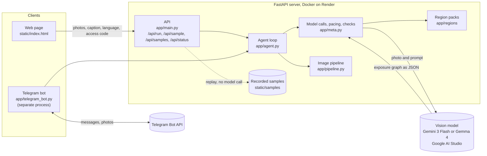
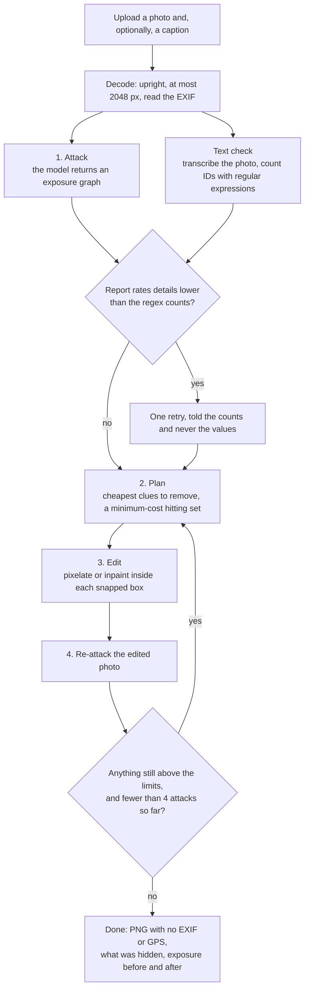
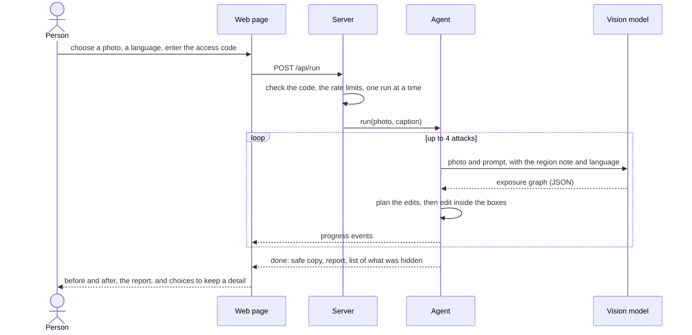
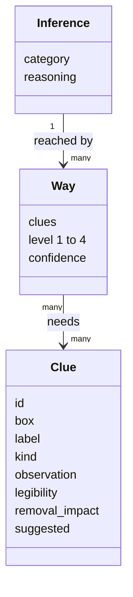
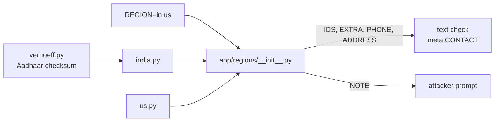
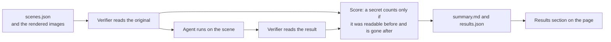
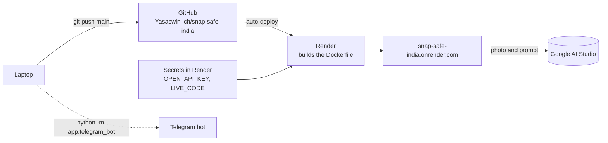

# Architecture

Diagrams of how Snap Safe India is put together and how a photo moves through it. They follow the same four steps the
project has always been explained with (attack, plan, edit, re-attack) and the file layout in the README. The prose is in
[how-it-works.md](how-it-works.md).

## The system

## What happens to one photo

## A live check, step by step

## What the model returns

A **way** is the smallest set of clues that is enough to reach a conclusion, at a precision from 1 (broad) to 4 (exact).
The planner removes clues until every way is blocked or low enough.

## Region packs

## The benchmark

## Build and deploy

