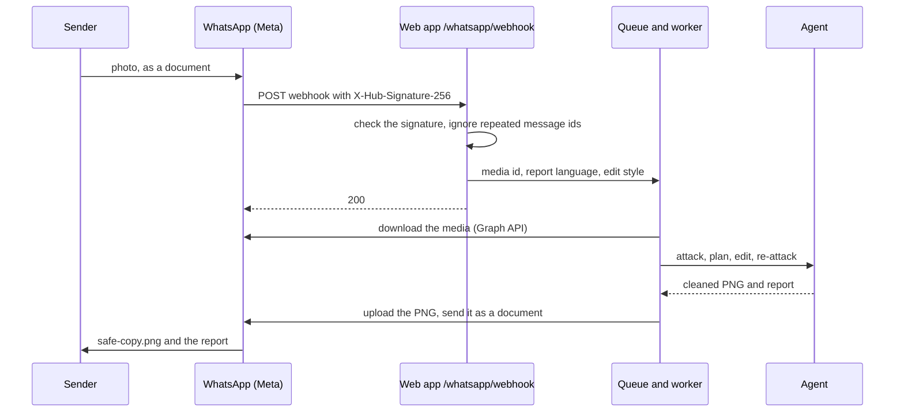

# WhatsApp bot

The same agent as the web page and the Telegram bot, behind a WhatsApp number. Someone messages the number a photo (best sent as a
document, so WhatsApp keeps its full quality) and gets back the cleaned copy with a short report. It uses Meta's WhatsApp Cloud API.

**Status.** The code is tested offline with a stand-in for the Graph API (`uv run python -m tests.test_whatsapp`, 9 checks) and against
a running server for the webhook handshake and the signature check. It has **not** been tried against real WhatsApp, because that needs
a Meta developer account and a number. Treat the first real message as the test.

## How it works

Telegram's bot polls for messages. WhatsApp pushes them: Meta calls `POST /whatsapp/webhook` on the web app for every incoming message.
The app answers 200 at once and puts the photo in a queue; one check runs at a time, like the Telegram bot. When it finishes, the app
uploads the cleaned PNG to the Graph API and sends it back as a document with the report as its caption (or as a second message when the
report is longer than WhatsApp's 1,024-character caption limit).

Messages the sender can type: `help`, `lang en|te|hi` (report language), `style clean|pixelate` (how hidden text is covered), and
`unlock <code>` only when the server sets `LIVE_CODE`. Each number is limited to `BOT_RUNS_PER_HOUR` photos an hour (default 3), shared
with the Telegram bot's setting, because the model's quota is the limit.

## Setup

1. At developers.facebook.com create an app of type **Business** and add the **WhatsApp** product. Meta gives you a **test phone number**
   and a **Phone number ID**; the test number can message only the recipient numbers you add and verify (up to five) until you add your own number.
2. Copy the **temporary access token** from the API Setup page. It lasts 24 hours; for anything longer, create a **system user** in
   Business Settings, give it the app with the `whatsapp_business_messaging` permission, and generate a permanent token.
3. From the app's **Settings, Basic** page copy the **App Secret**.
4. Put the four values in the web app's environment (on Render: the service's Environment tab):

   | Setting | Value |
   |---|---|
   | `WHATSAPP_TOKEN` | the access token |
   | `WHATSAPP_PHONE_ID` | the Phone number ID |
   | `WHATSAPP_VERIFY_TOKEN` | any string you choose |
   | `WHATSAPP_APP_SECRET` | the App Secret: every webhook call must carry a valid signature, so without it nothing is accepted |

5. In the app's **WhatsApp, Configuration** page set the callback URL to `https://<your site>/whatsapp/webhook` and the verify token to the
   string from step 4, press **Verify and save**, and subscribe to the **messages** field.
6. From a verified recipient number, send the test number `hi`. It should answer with the help text. Then send a photo as a document.

Until all of `WHATSAPP_TOKEN`, `WHATSAPP_PHONE_ID` and `WHATSAPP_VERIFY_TOKEN` are set, both routes answer 404, so deploying this code changes nothing
on a site that does not use it. To try it from a laptop, run the app and expose it with a tunnel (for example `ngrok http 8000`), then use the tunnel's HTTPS address in step 5.

## Limits and care

- WhatsApp allows free-form replies only within 24 hours of the sender's last message. The bot only ever replies to a message, so it stays inside that window.
- The photo goes to Meta (it is a WhatsApp message) and then to the model's host, as on the web page. Say so to anyone who uses it.
- Keep the token and the App Secret out of the repository: set them as secrets, never in `render.yaml` or `.env.example` with a value.
- One check at a time, so a second sender waits; the bot says how many photos are ahead.
- No WhatsApp message is stored by the app. The queue and the per-sender settings (language, style) live in memory and are lost on a restart.
