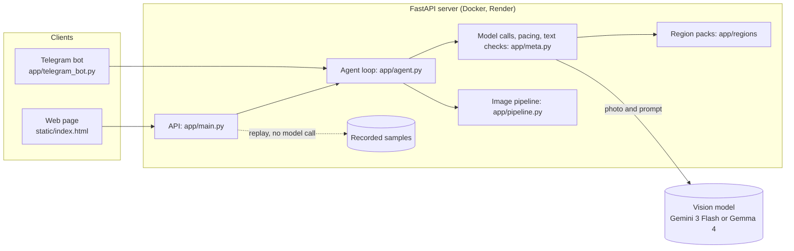

# Snap Safe India: Project Write-up

The short text for the event form is in [write-up.md](write-up.md). This is the long version, for judges who want the reasoning,
the design and the evidence. Numbers here are copied from the files in `bench/india/results`; where something was not measured,
it says so.

## 1. Project Title

**Snap Safe India**: a photo privacy agent for photos shared in India.

## 2. Abstract

People in India routinely post photographs that carry identity and payment details without meaning to: an Aadhaar or PAN card on
a table, a number plate, a courier label with a name and phone number, a house name board, a UPI screen. Snap Safe India looks at
a photo the way a stranger would, lists what that stranger could learn and how precisely, plans the fewest edits that hide it,
makes those edits, and attacks the edited photo again to check. It never prints the names, addresses or numbers it finds. It has
India-specific detection (Aadhaar with its checksum, PAN, GSTIN, voter ID, number plates including the BH series, UPI IDs, IFSC
codes, Indian phone numbers, PIN codes, address words), reports in English, Telugu or Hindi, a web page and a Telegram bot.
On five rendered scenes with planted fictional secrets, the agent with Gemini 3 Flash removed 19 of 19 secrets in one run per
scene; the deterministic text check that runs beside the model scored precision 0.937, recall 0.894 and F1 0.915 on 75
hand-written test texts. Both results are small and synthetic, and the write-up says what they do and do not show.

## 3. Problem Statement

A photo gives away more than its subject. Small, blurry or incidental text, reflections, labels and plates can each reveal a
name, a home, a phone number or an account. Existing tools ask the user to find and hide these themselves (manual blur or crop),
or hide only faces. A person about to post cannot easily tell what a determined stranger could extract, or whether their own
edit worked, and an edit that leaves half a name readable gives a false sense of safety.

## 4. Motivation and Relevance to India

Photographs in India often contain documents and identifiers, because photographing a card, a vehicle, a parcel or a payment
screen is an everyday way to share it with family, a shop, a delivery agent or a group chat, and the photo then travels on.
The details that show up are the ones that matter most here:

- **Identity documents:** an Aadhaar number or a PAN is used to identify a person to banks and services, so a readable one is more than a name.
- **Vehicle number plates:** a full plate points to one vehicle.
- **Addresses:** door and flat numbers, colony names, house name boards, wedding invitations and courier labels carry the most specific part of an address, which a stranger cannot get from anywhere else.
- **UPI IDs and payment screens:** they identify an account used for payments.
- **Indian-language text:** Telugu, Hindi and Tamil text appears on signs, boards and labels, and tools built around English text can miss it.

We make no statistical claim about how often these photos are shared or abused; the point is that the details are concrete, the
loss is hard to undo once a photo is posted, and a check before posting is cheap.

## 5. Proposed Solution

An agent that does what a careful investigator would, on the user's behalf and before the photo is posted:

1. **Attack:** a vision model builds an *exposure graph*: clues (a plate, a name board) and the inferences a stranger could draw from them (where you live, who you are), each with how precisely: broad, narrowed, specific or exact.
2. **Plan:** a minimum-cost hitting set picks the cheapest clues to remove so that nothing specific or exact can still be inferred.
3. **Edit:** each chosen clue is pixelated or inpainted inside its box only; every other pixel is unchanged.
4. **Re-attack:** the edited photo is attacked again, and anything still exposed goes through another round, up to four attacks.

The user sees what was found, what was hidden, what a stranger could learn before and after, and a cleaned PNG with no EXIF or
GPS data. The report states the level of exposure but never the values themselves.

## 6. System Architecture

The server is stateless: a photo lives in memory for one request. The Telegram bot is a separate process that uses the same
agent. The recorded samples replay with no key, so the page works for a demo even when the model quota is gone. More diagrams
are in [architecture.md](architecture.md) and the steps are described in [how-it-works.md](how-it-works.md).

## 7. Key Features

- **India detection:** Aadhaar (a 12-digit number must pass the Verhoeff checksum, so courier tracking numbers are not taken for one), PAN, GSTIN, voter ID, vehicle plates (including BH series), UPI IDs, IFSC codes, Indian mobile numbers, PIN codes and address words such as "Door No." and "Nagar".
- **Minimum edits:** the planner removes the cheapest set of clues that blocks every specific or exact inference, not everything.
- **Region packs:** India is one file; a small US pack is included; adding a country is one file ([adding-a-country.md](adding-a-country.md)).
- **A check that text cannot talk out of:** a deterministic read of the photo's text counts IDs and contact details beside the model, and detects notes addressed to an AI ("report nothing") in English, Hindi, Telugu and Tamil.
- **A last literal read** of the edited photo: a result that still shows a PIN code or ID number the first report called risky is not marked safe.
- **Report language:** English, Telugu or Hindi for the report's prose.
- **Telegram bot** and a **web page** with recorded sample runs, a before-and-after slider and a benchmark section.
- **Any OpenAI-compatible vision model** through two settings, with per-model request pacing.

## 8. Technology Stack

Python 3.11, FastAPI and Uvicorn, OpenCV, Pillow and NumPy for the image work, the OpenAI Python SDK talking to Google's Gemini
API (Gemini 3 Flash as the demo model, Gemma 4 open weights as a free fallback), a single-file HTML, CSS and JavaScript page,
the Telegram Bot API, Docker on Render, and `uv` for dependencies. The attack, plan, edit and re-attack loop and the image
pipeline come from the MIT-licensed project *before-you-post* by WhorideChicken, which we adapted and rebuilt for India.

## 9. Implementation Details

- **Exposure graph and planner** (`app/meta.py`, `app/agent.py`): the model returns clues with boxes and inferences with "ways" (smallest clue sets that suffice). `normalize()` coerces the model's JSON, drops ways that cite unknown clues, and keeps a clue with no usable box rather than lose it, since under-reporting is the worse failure.
- **Editing** (`app/pipeline.py`): pixelation and classic inpainting, composited back only inside the mask. Boxes from a model are rarely tight, so a box is snapped to the ink inside it; small boxes are widened first.
- **Deterministic text check** (`app/meta.py`, `app/regions/india.py`): regular expressions, with the Aadhaar number checked by `app/regions/verhoeff.py`. If the model rates details lower than the text check read, it gets one retry, told the counts and never the values.
- **Language** (`app/meta.py`): the language is an instruction added to the prompt that asks for the summary, each observation and each reasoning in Telugu or Hindi, while labels and edits stay English. An unknown code adds nothing, so it falls back to English.
- **Pacing:** `OPEN_RPM` spreads requests under the provider's per-minute limit; an optional second model can answer the re-attacks.
- **Benchmarks** (`bench/`): a rendered-scene benchmark with planted fictional secrets and a scorer, an offline detector benchmark, and a request counter. See section 11.

## 10. Privacy and Security Considerations

- Photos are held in memory for one request and are not stored by our server.
- To find the clues, the photo **is sent to the model's host** (Google's Gemini API, whose own data terms apply). We say so on the page and recommend staged photos for testing.
- The attacker is told never to output names, addresses or numbers; that is a prompt rule, not a filter. Our own benchmark counted how often a planted value was echoed in a report: 0 of 14 in the latest run, one run.
- **Prompt injection:** text in a photo can try to instruct the model ("ignore previous instructions", "report nothing"). The prompt says text in a photo is content, the rule is repeated after the photos, and a deterministic check detects such notes in English, Hindi, Telugu and Tamil; a result that stays talked down is never called verified.
- The output PNG has no EXIF or GPS data.
- Live runs need an access code on the deployed site, with per-visitor and daily limits, so the public page cannot spend the key. Keys and the code are never committed.
- **"Verified" is the agent's own judgment** after re-attacking, not proof. Edits are pixelation and inpainting, which look rougher than generative edits.

## 11. Testing and Benchmark Results

The evaluation has five separate parts. Details and commands are in the [README](../README.md) and [benchmark.md](benchmark.md).

**A. Deterministic text detector (measured, offline, reproducible).** 75 hand-written, made-up detail texts (18 with nothing
private) and 14 injection-note texts, scored per text and per kind of detail.

| | TP | FP | FN | Precision | Recall | F1 |
|---|---|---|---|---|---|---|
| India pack on | 59 | 4 | 7 | 0.937 | 0.894 | 0.915 |
| India pack off | 5 | 0 | 61 | 1.000 | 0.076 | 0.141 |
| Injection-note detector | 6 | 1 | 1 | 0.857 | 0.857 | 0.857 |

All 42 ordinary-format texts and 17 scene-like items were found; the 7 misses are formats we knew the patterns do not cover
(lowercase PAN and plates, a GSTIN ending in a letter, a Delhi plate with a letter in the number, an unlisted UPI handle,
Devanagari digits, Telugu-script addresses); the 4 false alarms are look-alikes (an invoice number, a batch code, `Ref-123456`,
"Open Colony Sale"). With the pack off, precision of 1.000 rests on 5 findings. A full run takes about 0.2 to 0.5 s on a laptop.
The texts are synthetic and written by us, so this is not accuracy on real photos, and it is **not** the accuracy of the model.

**B. Image benchmark with the AI model (measured, small, one run per scene).** Ten rendered Indian scenes with planted fictional
secrets; five core scenes run by default. With Gemini 3 Flash, India pack on, one run per scene: **19 of 19 secrets removed**,
8.8% of the photo changed on average, the control photo not flagged. Two of the five scenes come from before the final literal
check was added, and the same scenes had failed before (the ID card at 2 of 7, the Telugu sign at 1 of 4), so this shows the fix
works on those scenes and not that the agent is reliable in general. With the pack off, all five scenes have run: 18 of 19
secrets removed (8.0% of the photo changed) against 19 of 19 with it on, a one-secret gap in one run that proves nothing, and two
of the pack-on results come from older code, so it is not a clean comparison. The scenes are drawn, not photographed, and the verifier is the same kind of model as the
attacker. **We do not report precision, recall or F1 for this part**, because a photo has no agreed list of every clue.

**B2. Photograph-like images (one run each, partly incomplete).** Nine images supplied by the team (a chalkboard menu as the control, a
Telugu and English shop sign, a library card, a house gate, a Hindi UPI shop stand, a Hindi parcel, a Telugu house plate, and a Tamil shop sign and clinic sign), and three
generated photo-style images run by a teammate with Gemma 4 (a parcel, a payment screen, a number plate; 15 of 15 secrets removed, but the
parcel edit is far larger than the label). For the first four of the nine, Gemini's free daily quota ran out, so their re-check never finished
and they are **explicitly not verified**. The last three ran to completion: the agent marked the Hindi UPI shop stand and the Hindi parcel safe,
and **did not mark the Telugu house plate safe** (four attacks, the home still rated "specific"). The scorer reported every planted secret removed
on all three, but our own look at the edited images found Telugu text still readable on the house plate (the first line, the start of the house
number and of the colony name) and edit boxes offset from the text they should cover, so for Indian scripts that scorer is optimistic: it
counts a secret as removed only when the whole string is gone and compares text without vowel signs. The two Tamil signs were run afterwards with
Gemma 4 as attacker and reader (the Gemini quota was out): the shop sign was marked safe with its Tamil shop name partly readable and its boxes offset, and the clinic
sign was over-edited (38% of the frame), left the doctor's name readable and was not marked safe. Details are in [benchmark.md](benchmark.md).

**C. Language plumbing (verified offline).** 11 offline checks pass: the language reaches the prompt, unknown codes fall back to
English on the server and in the bot, Telugu and Hindi text (with conjuncts and joiners) survives JSON and the Telegram upload,
and the page offers exactly the server's languages. In a browser, Telugu and Hindi text rendered correctly on the page. The
benchmark's request counter has 4 more offline checks against a stand-in API.

**D. Live language quality (one live run each, no native-reader review).** We ran the made-up ID card through Gemini 3 Flash once
with the report in Telugu and once in Hindi. Both came back in the right script, with the clue labels in English and none of the
planted values in the text, and both read as fluent and sensible to us; nobody who reads Telugu or Hindi natively has reviewed
them. Only the report's prose changes language: the page labels, Telegram headings and verdicts, and clue labels stay English.
Hindi, Telugu and Tamil photographs have been run through the agent (see B2; the Tamil ones only with Gemma 4) but no reader has reviewed the edited images.

Other checks: the cleaned ID-card sample was read back after cleaning, and the Telegram bot ran once on real Telegram with the
made-up ID card (about a minute, and a box that was larger than needed). The deployed site answers; a full live run on it was
not checked, though the same run passed locally.

## 12. Challenges Faced

- **Quota.** Gemini 3 Flash's free tier gives 20 requests a day per project, which a five-scene run uses, so the pack-off run took two days' worth of attempts and live use needs billing.
- **Boxes that miss.** Models place boxes loosely; weaker models boxed a whole card or left a surname readable. We added box snapping, widening of small boxes, and a rule against boxing status icons.
- **A lenient scorer.** Our first scoring counted a half-hidden name as removed. It now also checks each word of a name, which lowered the early numbers and made them honest.
- **An agent that called a bad result safe.** In one run the ID card kept a name and PIN readable while the agent said it was safe; the last literal read was added for that.
- **Self-checking.** The same kind of model edits and checks, so "verified" can be wrong. A lite model as an independent re-checker boxed the whole photo, so it is off.
- **Indian scripts.** Text in Telugu, Hindi and Tamil needs to be read and, for injected notes, recognised; we added phrases for them, but number and address patterns remain English and ASCII-digit only.

## 13. Future Scope

- Fix the detector's known misses: case-insensitive PAN and plates, the GSTIN last character, more UPI handles, Devanagari and Telugu digits, Telugu and Hindi address words.
- Have Telugu and Hindi readers review the reports, try Tamil photos, fix the box placement and the scorer for Indian scripts, and test real phone photographs (glare, angle) instead of rendered scenes.
- Run the other five benchmark scenes, and repeat runs so the counts and the scores have a spread, once there is quota or billing.
- Use an independent model or an on-device model for the re-check, and generative edits that look more natural.
- Translate the page and bot interface; more region packs; faces and non-text clues scored in the benchmark.

## 14. Conclusion

Snap Safe India makes the question "what could a stranger learn from this photo?" answerable before posting, in a way that fits
how photos are shared in India: documents, plates, labels, addresses and UPI screens, with Indian-script text and report
languages. Its deterministic checks are measured and reproducible, and its model-driven results are encouraging but small, from
one run on rendered scenes. We are explicit about the limits: "verified" is the agent's own judgment, the photo is sent to a
model host, the language quality is unchecked, and the benchmark does not stand in for real photos. It is a tool for looking
twice, not a guarantee, and it asks the user to look at the picture before they post it.
